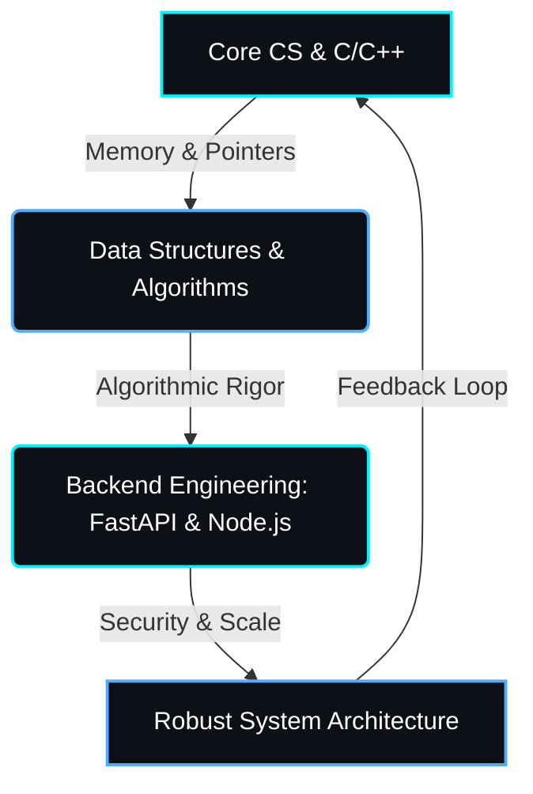

<div align="center">

  

  <br/>

  

  <br/><br/>

  
  

</div>

---

<div align="center">

### 🧠 About Me

</div>

```json
{
  "developer": "Abdulla Bin Aziz",
  "focus": ["Backend Engineering", "System Design", "Core Data Structures", "Application Security"],
  "core_languages": ["C", "C++", "Python", "JavaScript"],
  "frameworks": ["FastAPI", "Node.js"],
  "architecture_mindset": "Clean, explicit, and edge-case safe logic.",
  "open_to": ["Backend internships", "Junior developer roles", "Collaborative projects"]
}
```

---

<div align="center">

### 🛠️ Tech Stack

<p>
  
  
  
  
  
  
</p>

<p>
  
  
  
  
  
</p>

</div>

---

<div align="center">

### 🗺️ Learning & Architecture Flow

</div>



---

<div align="center">

### 🎯 Current Focus

| Area | Status |
|:--|:--|
| Algorithmic Problem Solving | 🟢 Active |
| API Engineering (FastAPI / Node.js) | 🟢 Active |
| Memory Safety & Pointers (C/C++) | 🟡 In Progress |
| Application Security (OWASP Top 10) | 🟡 In Progress |
| System Design & Architecture | 🟡 In Progress |

</div>

---

<div align="center">

### 📊 GitHub Stats


<br/>


</div>

---

<div align="center">

### 🏆 Trophies


</div>

---

<div align="center">

### 📫 Let's Connect

<p>
  <a href="https://github.com/code-abdullabinaziz">
    
  </a>
  <a href="https:///www.linkedin.com/in/abdulla-bin-aziz-9077a740b">  
    
  </a>
  <a href="mailto:YOUR_EMAIL">
    
  </a>
</p>


</div>
